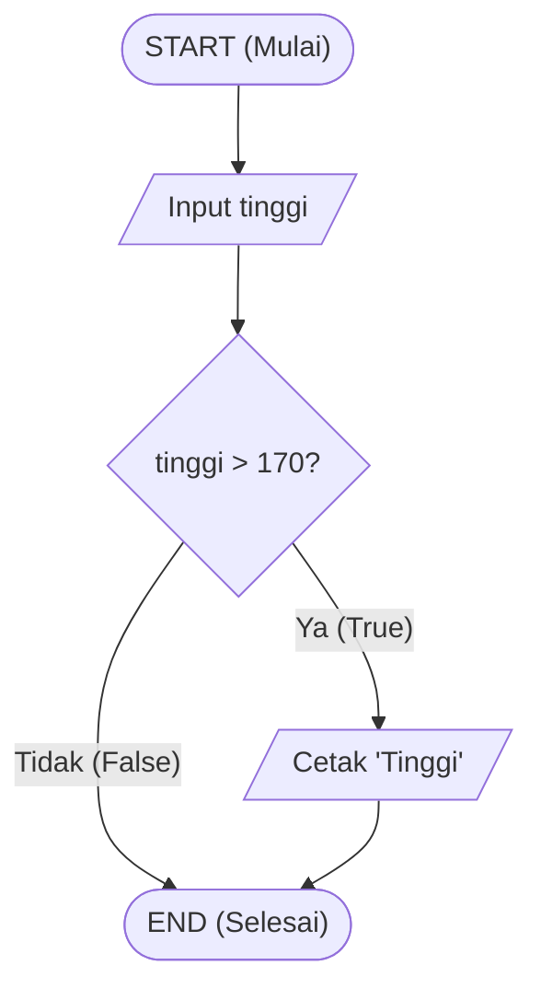
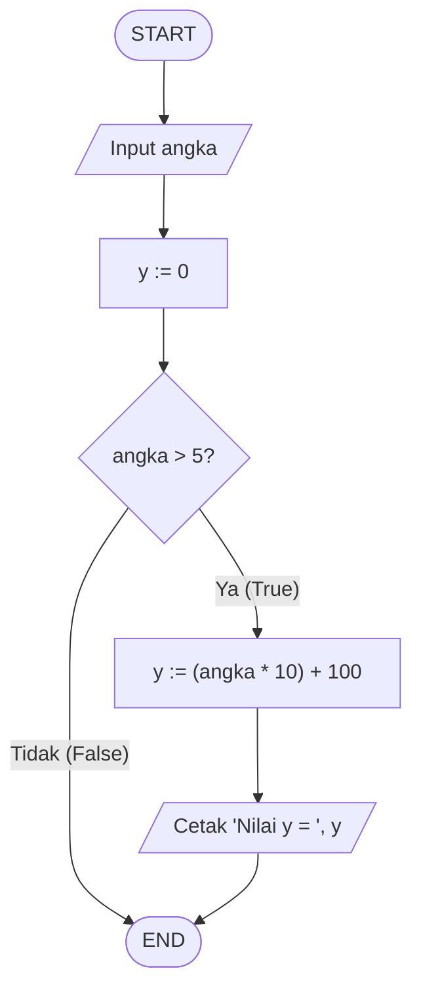
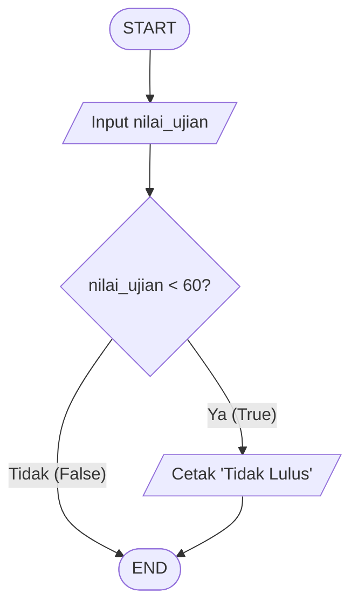
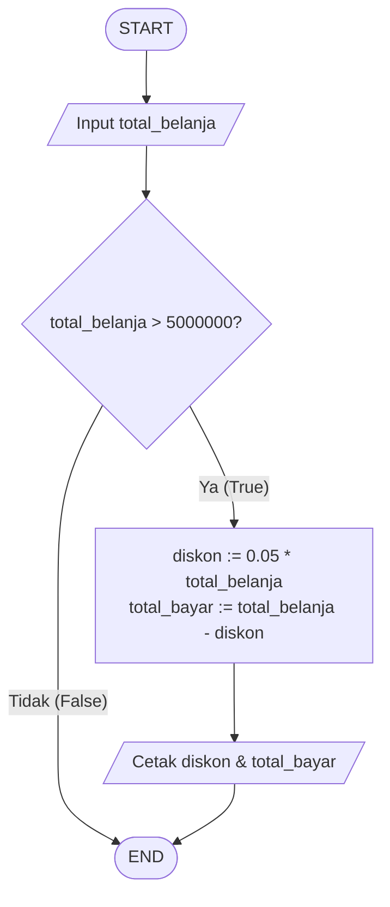
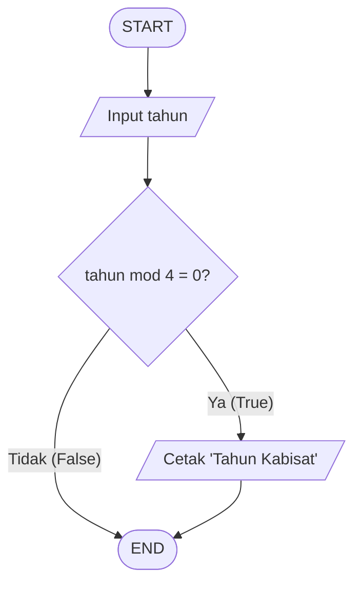
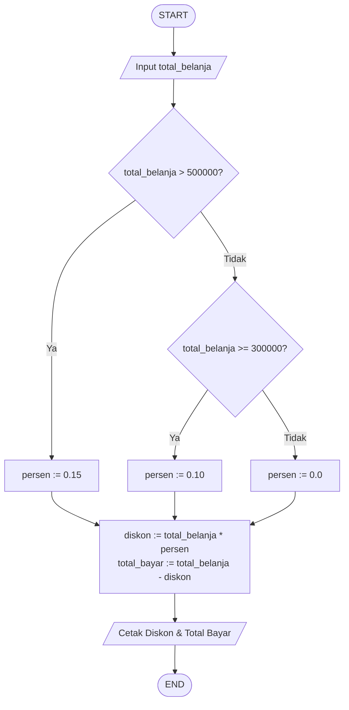
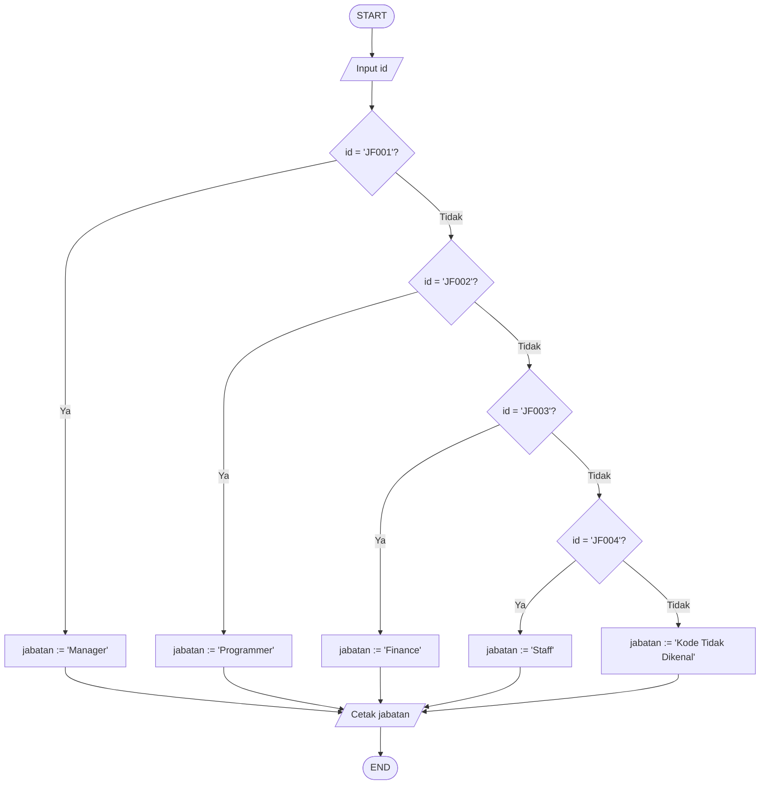
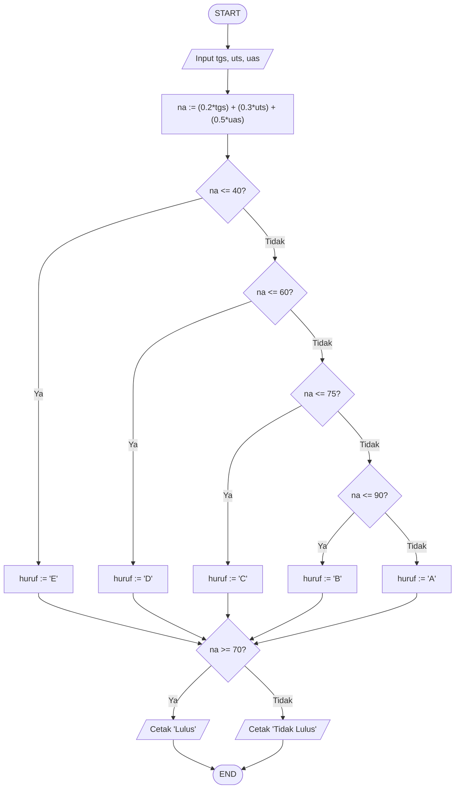
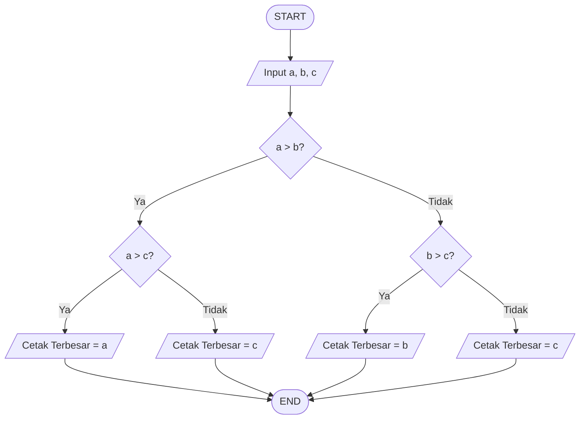
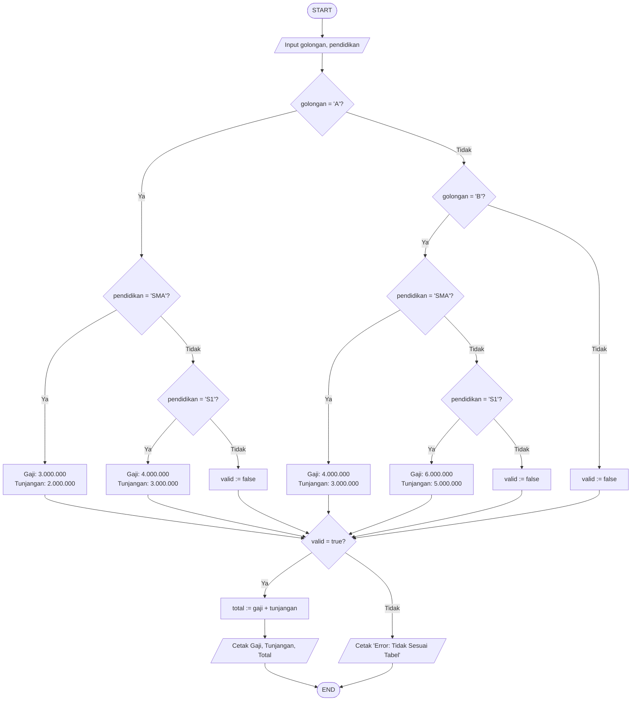

# 📐 PANDUAN LENGKAP: KODE PASCAL, PENJELASAN LOGIKA & DIAGRAM ALIR (FLOWCHART ANSI)
> **Mata Kuliah:** Algoritma & Pemrograman 1 / Pemrograman 1 (Pascal)  
> **Institusi:** Universitas Indraprasta PGRI (UNINDRA) - S1 Sistem Informasi  
> **Dosen Pengampu:** Pak Rizki  
> **Direktori Sumber Kode:** `C:\Users\haike\Kuliah\Algoritma_dan_Pemrograman_1\03_source_code_pascal\`  
> **Repositori Cloud & Binder:** `academic-digital-binder` (GitHub: `hekall21/academic-digital-binder`)

---

## 🧭 Peta Konsep Struktur Percabangan (Selection Control Structure)

Dalam pemrograman dan algoritma Pascal, percabangan digunakan untuk mengarahkan alur program berdasarkan pengujian kondisi logika (*Boolean Expression*):

| Jenis Percabangan | Kata Kunci Pascal | Jumlah Cabang | Kapan Digunakan? | Contoh di Perkuliahan |
| :--- | :--- | :---: | :--- | :--- |
| **Satu Kasus (IF Tunggal)** | `if (kondisi) then ...` | 1 | Aksi hanya dijalankan jika kondisi bernilai **BENAR (True)**. Jika salah, program langsung melewatinya tanpa melakukan apapun. | Tinggi badan > 170, hitung rumus Y jika angka > 5, tidak lulus jika ujian < 60, diskon 5% jika belanja > 5jt. |
| **Dua Kasus (IF-ELSE)** | `if (kondisi) then ... else ...` | 2 | Ada 2 alternatif: Aksi-1 dijalankan jika Benar, Aksi-2 dijalankan jika Salah. | Bilangan ganjil/genap, lulus/tidak lulus, positif/negatif. |
| **Multi-Kasus (IF Majemuk)** | `if ... then ... else if ... then ... else ...` | $>2$ | Memilih salah satu dari 3 atau lebih pilihan kondisi yang saling eksklusif (bertingkat). | Diskon belanja bertingkat (15%, 10%, 0%), kode jabatan (JF001-JF004), grade nilai (A, B, C, D, E). |
| **Percabangan Bersarang (*Nested IF*)** | `if ... then begin if ... then ... end` | Bertingkat | Ada struktur `IF` di dalam blok instruksi `IF` lainnya. Digunakan saat suatu kondisi baru boleh dicek jika kondisi induknya sudah terpenuhi. | Mencari bilangan terbesar dari 3 angka ($A, B, C$), perhitungan gaji berdasarkan Golongan (A/B) dan Pendidikan (SMA/S1). |

---

## 📑 Katalog Seluruh 24 Berkas Kode Pascal di Repositori

| No | Nama File `.pas` | Topik Materi | Logika Percabangan | Penjelasan Singkat Fungsi Program |
| :-: | :--- | :--- | :--- | :--- |
| 1 | `p05_tugas1_manusia_tinggi.pas` | Algoritma P5 | IF 1 Kasus | Memeriksa tinggi badan. Jika $> 170$ cm, cetak `"Tinggi"`. |
| 2 | `p05_tugas2_hitung_y.pas` | Algoritma P5 | IF 1 Kasus | Jika angka $> 5$, hitung $Y = \text{angka} \times 10 + 100$ lalu cetak nilai $Y$. |
| 3 | `p05_tugas3_tidak_lulus.pas` | Algoritma P5 | IF 1 Kasus | Jika nilai ujian $< 60$, cetak keterangan `"Tidak Lulus"`. |
| 4 | `p05_tugas4_diskon_5jt.pas` | Algoritma P5 | IF 1 Kasus | Jika total belanja $> 5.000.000$, berikan diskon $5\%$ ($0.05 \times \text{belanja}$). |
| 5 | `p05_tugas5_tahun_kabisat.pas` | Algoritma P5 | IF 1 Kasus | Memeriksa apakah tahun habis dibagi 4 (`tahun mod 4 = 0`) $\rightarrow$ `"Tahun Kabisat"`. |
| 6 | `p05_nilai_akhir.pas` | Algoritma P5 | IF-ELSE IF & IF-ELSE | Menghitung bobot nilai tugas, UTS, UAS menjadi nilai akhir dan status kelulusan. |
| 7 | `p06_tugas1_diskon_belanja.pas` | Algoritma P6 | IF Majemuk | Diskon belanja bertingkat: $>500$rb ($15\%$), $300$rb-$500$rb ($10\%$), $<300$rb ($0\%$). |
| 8 | `p06_tugas1_diskon_gaya_dosen.pas` | Algoritma P6 | IF Majemuk | Format standar dosen Notepad Pak Rizki untuk diskon belanja bertingkat. |
| 9 | `p06_tugas1_diskon_pak_rizki_var_d.pas` | Algoritma P6 | IF Majemuk | Gaya live-coding dosen menggunakan variabel ringkas `d` untuk diskon. |
| 10 | `p06_tugas1_diskon_pak_rizki_var_diskon.pas` | Algoritma P6 | IF Majemuk | Gaya live-coding dosen menggunakan variabel `diskon` deskriptif. |
| 11 | `p06_tugas2_jabatan_pegawai.pas` | Algoritma P6 | IF Majemuk | Menentukan nama jabatan dari kode: JF001 (Manager), JF002 (Programmer), JF003 (Finance), JF004 (Staff). |
| 12 | `pemro_p05_contoh1_bilangan.pas` | Pemrograman P5 | IF Majemuk | Menguji angka: Positif ($>0$), Negatif ($<0$), atau Nol ($=0$). |
| 13 | `pemro_p05_contoh2_bmi.pas` | Pemrograman P5 | IF Majemuk | Menghitung Indeks Massa Tubuh ($BMI = \text{berat} / \text{tinggi}^2$) dan kategori berat badan. |
| 14 | `pemro_p05_tugas_nilai_akhir.pas` | Pemrograman P5 | IF Majemuk | Tugas Slide 7: Bobot 20% Tugas + 30% UTS + 50% UAS $\rightarrow$ Grade A, B, C, D, E & Lulus $\ge 70$. |
| 15 | `pemro_p05_nilai_gaya_dosen.pas` | Pemrograman P5 | IF Majemuk | Format live DOSBox Pak Rizki: variabel `tgs, uts, uas, na: real; huruf: string;`, pembulatan `na:0:0`. |
| 16 | `pemro_p06_contoh1_tiga_bilangan_terbesar.pas` | Pemrograman P6 | Nested IF | Menentukan angka terbesar dari 3 input ($A, B, C$) persis Slide 5. |
| 17 | `p06_tantangan_terbesar_3_angka.pas` | Pemrograman P6 | Nested IF | Program tantangan live GMeet Pak Rizki (uji coba $A=45, B=90, C=15 \rightarrow 90$). |
| 18 | `pemro_p06_tugas_gaji_karyawan_nested_if.pas` | Pemrograman P6 | Nested IF | Tugas Slide 7: Menghitung Gaji Pokok & Tunjangan Golongan (A/B) dan Pendidikan (SMA/S1). |
| 19 | `pemro_p06_tugas_gaji_karyawan_mobile_friendly.pas` | Pemrograman P6 | Nested IF | Versi khusus ramah HP (iOS/Android): Anti bug buffer Enter char, toleransi spasi keyboard HP. |
| 20 | `program_if.pas` | Pemrograman P5 | IF Majemuk | Salinan bersih file unduhan mahasiswa: evaluasi bilangan positif, negatif, nol. |
| 21 | `p11_pantulan_bola.pas` | Pemrograman P11 | Perulangan (Loop) | Simulasi tinggi pantulan bola fisik menggunakan perulangan. |
| 22 | `p14_pola_bintang.pas` | Pemrograman P14 | Nested Loop | Mencetak pola segitiga bintang menggunakan perulangan bersarang `for..to..do`. |
| 23 | `p15_array_1d_analisis.pas` | Pemrograman P15 | Larik 1 Dimensi | Mengolah kumpulan data nilai mahasiswa dalam array 1D (total, rata-rata, max, min). |
| 24 | `p15_array_2d_matriks.pas` | Pemrograman P15 | Larik 2 Dimensi | Operasi penjumlahan dan perkalian matriks baris $\times$ kolom menggunakan array 2D. |

---

## 📊 Bedah 10 Studi Kasus: Diagram Alir (Flowchart ANSI), Logika & Kode Lengkap

---

### 1. P5 Algoritma: Manusia Tinggi (Tinggi Badan > 170 cm)
* **File:** [`p05_tugas1_manusia_tinggi.pas`](file:///C:/Users/haike/Kuliah/Algoritma_dan_Pemrograman_1/03_source_code_pascal/p05_tugas1_manusia_tinggi.pas)
* **Jenis Percabangan:** **IF Tunggal (1 Kasus)**.
* **Logika:** Program membaca input `tinggi`. Jika nilai `tinggi > 170` bernilai benar (True), program mencetak `"Tinggi"`. Jika bernilai salah (False), program langsung selesai tanpa melakukan aksi apapun.

#### Diagram Alir ANSI (Flowchart):


#### Kode Pascal:
```pascal
program manusia_tinggi;
uses crt;
var
  tinggi : integer;
begin
  clrscr;
  write('Masukkan tinggi badan (cm) : '); readln(tinggi);
  if (tinggi > 170) then
    writeln('Tinggi');
  readln;
end.
```

---

### 2. P5 Algoritma: Hitung Nilai Y ($Y = \text{angka} \times 10 + 100$ Jika Angka > 5)
* **File:** [`p05_tugas2_hitung_y.pas`](file:///C:/Users/haike/Kuliah/Algoritma_dan_Pemrograman_1/03_source_code_pascal/p05_tugas2_hitung_y.pas)
* **Jenis Percabangan:** **IF Tunggal (1 Kasus)**.
* **Logika:** Dosen Pak Rizki menguji angka `10`. Karena $10 > 5$ (True), maka $Y = (10 \times 10) + 100 = 200$.

#### Diagram Alir ANSI (Flowchart):


#### Kode Pascal:
```pascal
program hitung_nilai_y;
uses crt;
var
  angka, y : integer;
begin
  clrscr;
  write('Masukkan angka : '); readln(angka);
  if (angka > 5) then
  begin
    y := (angka * 10) + 100;
    writeln('Nilai y adalah : ', y);
  end;
  readln;
end.
```

---

### 3. P5 Algoritma: Status Ujian Kurang dari 60 "Tidak Lulus"
* **File:** [`p05_tugas3_tidak_lulus.pas`](file:///C:/Users/haike/Kuliah/Algoritma_dan_Pemrograman_1/03_source_code_pascal/p05_tugas3_tidak_lulus.pas)
* **Jenis Percabangan:** **IF Tunggal (1 Kasus)**.
* **Logika:** Dosen Pak Rizki menguji angka `60`. Karena $60 < 60$ bernilai **Salah (False)**, maka teks `"Tidak Lulus"` tidak dicetak.

#### Diagram Alir ANSI (Flowchart):


#### Kode Pascal:
```pascal
program status_ujian;
uses crt;
var
  nilai_ujian : integer;
begin
  clrscr;
  write('Masukkan nilai ujian : '); readln(nilai_ujian);
  if (nilai_ujian < 60) then
    writeln('Tidak Lulus');
  readln;
end.
```

---

### 4. P5 Algoritma: Diskon Belanja Lebih dari 5 Juta (5%)
* **File:** [`p05_tugas4_diskon_5jt.pas`](file:///C:/Users/haike/Kuliah/Algoritma_dan_Pemrograman_1/03_source_code_pascal/p05_tugas4_diskon_5jt.pas)
* **Jenis Percabangan:** **IF Tunggal (1 Kasus)**.
* **Logika:** Jika `total_belanja > 5000000`, hitung diskon $5\% = 0.05 \times \text{total\_belanja}$ dan total bayar.

#### Diagram Alir ANSI (Flowchart):


#### Kode Pascal:
```pascal
program diskon_lima_juta;
uses crt;
var
  total_belanja, diskon, total_bayar : real;
begin
  clrscr;
  write('Masukkan total belanja (Rp) : '); readln(total_belanja);
  if (total_belanja > 5000000) then
  begin
    diskon := 0.05 * total_belanja;
    total_bayar := total_belanja - diskon;
    writeln('Diskon 5%   : Rp ', diskon:0:0);
    writeln('Total Bayar : Rp ', total_bayar:0:0);
  end;
  readln;
end.
```

---

### 5. P5 Algoritma: Penentuan Tahun Kabisat
* **File:** [`p05_tugas5_tahun_kabisat.pas`](file:///C:/Users/haike/Kuliah/Algoritma_dan_Pemrograman_1/03_source_code_pascal/p05_tugas5_tahun_kabisat.pas)
* **Jenis Percabangan:** **IF Tunggal (1 Kasus)**.
* **Logika:** Tahun kabisat habis dibagi 4 (`tahun mod 4 = 0`). Uji coba dosen: `2024` habis dibagi 4 $\rightarrow$ `"Tahun Kabisat"`.

#### Diagram Alir ANSI (Flowchart):


#### Kode Pascal:
```pascal
program cek_kabisat;
uses crt;
var
  tahun : integer;
begin
  clrscr;
  write('Masukkan tahun : '); readln(tahun);
  if (tahun mod 4 = 0) then
    writeln('Tahun Kabisat');
  readln;
end.
```

---

### 6. P6 Algoritma: Diskon Belanja Bertingkat (15%, 10%, 0%)
* **File:** [`p06_tugas1_diskon_pak_rizki_var_diskon.pas`](file:///C:/Users/haike/Kuliah/Algoritma_dan_Pemrograman_1/03_source_code_pascal/p06_tugas1_diskon_pak_rizki_var_diskon.pas)
* **Jenis Percabangan:** **IF Majemuk (*IF-THEN-ELSE IF*)**.
* **Logika Dosen:**
  - $> 500.000 \rightarrow$ diskon $15\%$ ($0.15$). Contoh belanja $501.000 \rightarrow$ Bayar Rp 425.850.
  - $300.000$ s.d $500.000 \rightarrow$ diskon $10\%$ ($0.10$). Contoh belanja $325.200 \rightarrow$ Bayar Rp 292.680.
  - $< 300.000 \rightarrow$ diskon $0\%$.

#### Diagram Alir ANSI (Flowchart):


#### Kode Pascal:
```pascal
program diskon_bertingkat;
uses crt;
var
  total_belanja, diskon, total_bayar : real;
begin
  clrscr;
  write('Masukkan total belanja : '); readln(total_belanja);
  if (total_belanja > 500000) then
    diskon := total_belanja * 0.15
  else if (total_belanja >= 300000) then
    diskon := total_belanja * 0.10
  else
    diskon := 0;

  total_bayar := total_belanja - diskon;
  writeln('Potongan Diskon : Rp ', diskon:0:0);
  writeln('Total Bayar     : Rp ', total_bayar:0:0);
  readln;
end.
```

---

### 7. P6 Algoritma: Penentuan Jabatan Karyawan (JF001 - JF004)
* **File:** [`p06_tugas2_jabatan_pegawai.pas`](file:///C:/Users/haike/Kuliah/Algoritma_dan_Pemrograman_1/03_source_code_pascal/p06_tugas2_jabatan_pegawai.pas)
* **Jenis Percabangan:** **IF Majemuk (*IF-THEN-ELSE IF*)**.
* **Logika:** Mengonversi string kode jabatan: `JF001` (Manager), `JF002` (Programmer), `JF003` (Finance), `JF004` (Staff).

#### Diagram Alir ANSI (Flowchart):


#### Kode Pascal:
```pascal
program jabatan_pegawai;
uses crt;
var
  id, jabatan : string;
begin
  clrscr;
  write('Masukkan kode jabatan : '); readln(id);
  if (id = 'JF001') then jabatan := 'Manager'
  else if (id = 'JF002') then jabatan := 'Programmer'
  else if (id = 'JF003') then jabatan := 'Finance'
  else if (id = 'JF004') then jabatan := 'Staff'
  else jabatan := 'Kode Tidak Dikenal';

  writeln('Jabatan : ', jabatan);
  readln;
end.
```

---

### 8. Pemrograman P5: Evaluasi Nilai Akhir (Gaya Dosen Pak Rizki)
* **File:** [`pemro_p05_nilai_gaya_dosen.pas`](file:///C:/Users/haike/Kuliah/Algoritma_dan_Pemrograman_1/03_source_code_pascal/pemro_p05_nilai_gaya_dosen.pas)
* **Jenis Percabangan:** **IF Majemuk Berantai & IF-ELSE**.
* **Logika:**
  - Rumus: $NA = (0.2 \times \text{tgs}) + (0.3 \times \text{uts}) + (0.5 \times \text{uas})$
  - Nilai Huruf: $NA \le 40$ ('E'), $\le 60$ ('D'), $\le 75$ ('C'), $\le 90$ ('B'), selain itu ('A').
  - Kelulusan: $NA \ge 70 \rightarrow$ `"selamat anda dinyatakan lulus"`, selain itu `"anda tidak dinyatakan lulus"`.

#### Diagram Alir ANSI (Flowchart):


#### Kode Pascal:
```pascal
program nilai;
uses crt;
var
  tgs, uts, uas, na : real;
  huruf             : string;
begin
  clrscr;
  write('nilai tugas   : '); readln(tgs);
  write('nilai uts     : '); readln(uts);
  write('nilai uas     : '); readln(uas);
  na := (0.2 * tgs) + (0.3 * uts) + (0.5 * uas);
  writeln('nilai akhir   : ', na:0:0);

  if na <= 40 then huruf := 'E'
  else if na <= 60 then huruf := 'D'
  else if na <= 75 then huruf := 'C'
  else if na <= 90 then huruf := 'B'
  else huruf := 'A';

  writeln('nilai huruf   : ', huruf);
  if na >= 70 then writeln('selamat anda dinyatakan lulus')
  else writeln('anda tidak dinyatakan lulus');
  readln;
end.
```

---

### 9. Pemrograman P6: Tantangan GMeet 3 Bilangan Terbesar (Nested IF)
* **File:** [`p06_tantangan_terbesar_3_angka.pas`](file:///C:/Users/haike/Kuliah/Algoritma_dan_Pemrograman_1/03_source_code_pascal/p06_tantangan_terbesar_3_angka.pas)
* **Jenis Percabangan:** **Percabangan Bersarang (*Nested IF - IF di dalam IF*)**.
* **Logika:** Dosen menguji $A=45, B=90, C=15$. Pengujian $A > B$ bernilai SALAH $\rightarrow$ cabang A diabaikan $\rightarrow$ masuk ke cabang ELSE: $B > C$ ($90 > 15$) bernilai BENAR $\rightarrow$ Terbesar $= 90$.

#### Diagram Alir ANSI (Flowchart):


#### Kode Pascal:
```pascal
program tantangan_tiga_bilangan_terbesar;
uses crt;
var
  a, b, c : integer;
begin
  clrscr;
  write('Masukkan Bilangan Pertama (A) : '); readln(a);
  write('Masukkan Bilangan Kedua   (B) : '); readln(b);
  write('Masukkan Bilangan Ketiga  (C) : '); readln(c);

  if (a > b) then
  begin
    if (a > c) then
      writeln('Bilangan Terbesar adalah : ', a)
    else
      writeln('Bilangan Terbesar adalah : ', c);
  end
  else
  begin
    if (b > c) then
      writeln('Bilangan Terbesar adalah : ', b)
    else
      writeln('Bilangan Terbesar adalah : ', c);
  end;
  readln;
end.
```

---

### 10. Pemrograman P6: Tugas Gaji Karyawan (Nested IF Golongan & Pendidikan)
* **File:** [`pemro_p06_tugas_gaji_karyawan_mobile_friendly.pas`](file:///C:/Users/haike/Kuliah/Algoritma_dan_Pemrograman_1/03_source_code_pascal/pemro_p06_tugas_gaji_karyawan_mobile_friendly.pas)
* **Jenis Percabangan:** **Percabangan Bersarang (*Nested IF*)**.
* **Logika:**
  - Jika Golongan = `'A'`: Jika Pendidikan `'SMA'` $\rightarrow$ Gaji 3 Juta, Tunjangan 2 Juta. Jika `'S1'` $\rightarrow$ Gaji 4 Juta, Tunjangan 3 Juta.
  - Jika Golongan = `'B'`: Jika Pendidikan `'SMA'` $\rightarrow$ Gaji 4 Juta, Tunjangan 3 Juta. Jika `'S1'` $\rightarrow$ Gaji 6 Juta, Tunjangan 5 Juta.
  - Total Gaji = Gaji Pokok + Tunjangan.
  - Dilengkapi fitur ramah HP (*mobile-friendly*) untuk mencegah error buffer enter dan auto-spacing keyboard smartphone.

#### Diagram Alir ANSI (Flowchart):


#### Kode Pascal:
```pascal
program hitung_gaji_karyawan;
uses crt;
var
  golongan, pendidikan : string;
  gaji_pokok, tunjangan, total_gaji : longint;
  valid : boolean;
begin
  clrscr;
  writeln('Input Golongan Karyawan (A/B):'); readln(golongan);
  writeln('Input Pendidikan Karyawan (SMA/S1):'); readln(pendidikan);

  golongan := upcase(golongan);
  pendidikan := upcase(pendidikan);
  gaji_pokok := 0; tunjangan := 0; valid := true;

  if (golongan = 'A') or (golongan = 'A ') then
  begin
    if (pendidikan = 'SMA') or (pendidikan = 'SMA ') then
    begin gaji_pokok := 3000000; tunjangan := 2000000; end
    else if (pendidikan = 'S1') or (pendidikan = 'S1 ') then
    begin gaji_pokok := 4000000; tunjangan := 3000000; end
    else valid := false;
  end
  else if (golongan = 'B') or (golongan = 'B ') then
  begin
    if (pendidikan = 'SMA') or (pendidikan = 'SMA ') then
    begin gaji_pokok := 4000000; tunjangan := 3000000; end
    else if (pendidikan = 'S1') or (pendidikan = 'S1 ') then
    begin gaji_pokok := 6000000; tunjangan := 5000000; end
    else valid := false;
  end
  else valid := false;

  writeln('----------------------------------------------');
  if (valid) then
  begin
    total_gaji := gaji_pokok + tunjangan;
    writeln('Gaji Pokok               : Rp ', gaji_pokok);
    writeln('Tunjangan                : Rp ', tunjangan);
    writeln('Gaji yang didapat adalah : Rp ', total_gaji);
  end
  else
    writeln('Error: Golongan atau Pendidikan tidak sesuai tabel!');
  readln;
end.
```

---
*Dokumen ini disusun sebagai panduan akademik resmi persiapan Kuis, Praktikum Mandiri, dan Ujian Tengah Semester (UTS) Open Book Unindra.*
